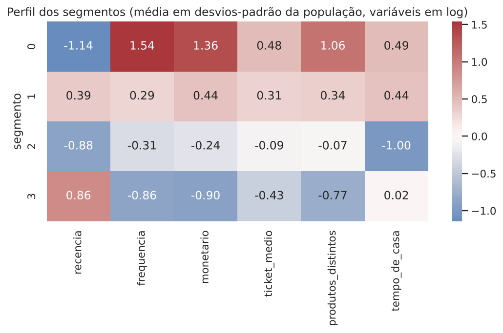
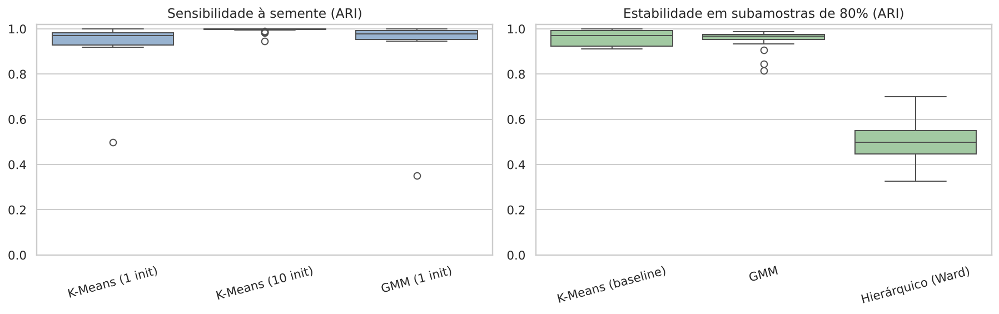
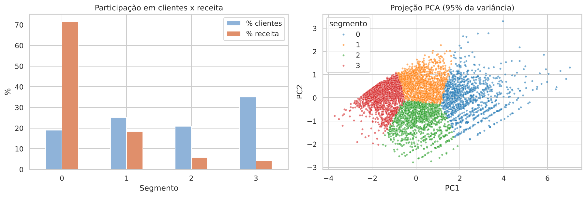

# Segmentação de clientes no Online Retail II

Segmentação não supervisionada de clientes de um e-commerce britânico de presentes, a partir de dois anos de transações. O trabalho parte do RFM clássico, compara K-Means, GMM e clustering hierárquico (Ward) e escolhe o número de segmentos com base em métricas internas, estabilidade e interpretação de negócio.

O notebook completo, com todas as decisões justificadas, está em [`notebooks/01_segmentacao_clientes.ipynb`](notebooks/01_segmentacao_clientes.ipynb).

## Resultado

O K-Means com K=4 foi o modelo escolhido. Os quatro segmentos, ordenados por valor:

| Segmento | % dos clientes | % da receita | Recência (dias) | Faturas | Gasto acumulado |
|---|---:|---:|---:|---:|---:|
| 0. Clientes-chave | 19,0% | 71,6% | 15 | 13 | £ 5.118 |
| 1. Fiéis em esfriamento | 25,1% | 18,5% | 157 | 5 | £ 1.580 |
| 2. Novos em desenvolvimento | 20,8% | 5,9% | 23 | 3 | £ 708 |
| 3. Inativos | 35,1% | 4,1% | 398 | 1 | £ 291 |

Valores são medianas por segmento. A concentração é forte: um em cada cinco clientes responde por quase três quartos da receita, então proteger o segmento de maior valor é a prioridade de retenção.



## Dados

[Online Retail II](https://archive.ics.uci.edu/dataset/502/online+retail+ii) (UCI Machine Learning Repository, também disponível no Kaggle): transações de uma loja online registrada no Reino Unido entre 01/12/2009 e 09/12/2011. A empresa vende presentes e muitos clientes são atacadistas. A base original tem 1.067.371 linhas e 8 colunas.

O arquivo não está versionado neste repositório. Para reproduzir, baixe o CSV e salve como `data/online_retail_II.csv`. A licença do dataset é CC BY 4.0 (Chen, D., 2012).

## Metodologia

**Limpeza.** O notebook mostra um funil com cada regra e quantas linhas ela remove. Ao final sobram 776.577 linhas de venda (73% da base) e 5.852 clientes.

| Regra | Linhas removidas |
|---|---:|
| Duplicatas exatas | 34.335 |
| Cancelamentos (fatura iniciada em "C") | 19.104 |
| Sem Customer ID | 234.437 |
| Códigos que não são produto (frete, taxas, ajustes) | 2.858 |
| Quantidade ou preço não positivos | 60 |

Os cancelamentos saem das compras, mas o valor devolvido por cliente é guardado para descrever os segmentos.

**Variáveis.** Recência, frequência (faturas distintas) e monetário (receita bruta) por cliente. Todas são muito assimétricas, então aplico `log1p` e `StandardScaler`. Ticket médio e produtos distintos foram testados como variáveis extras e ficaram de fora do modelo: são correlacionados com o monetário (0,69 e 0,75) e pioraram as métricas de separação sem ganho de estabilidade. Elas são usadas para descrever os segmentos.

**Modelos.** O baseline é o K-Means. Os concorrentes são GMM e clustering hierárquico com ligação Ward, todos no mesmo espaço de variáveis.

**Escolha de K.** Varredura de K=2 a K=10 com inércia (Elbow), Silhouette, Davies-Bouldin e Calinski-Harabasz, mais BIC para o GMM e dendrograma para o Ward. K=2 tem a maior silhouette, mas só separa ativos de inativos. K=4 é um máximo local no K-Means e entrega segmentos acionáveis.

**Estabilidade.** Adjusted Rand Index contra a partição de referência, com 30 sementes diferentes e 30 subamostras de 80% dos clientes.

## Comparação dos modelos (K=4)

| Modelo | Silhouette | Davies-Bouldin | Menor cluster | ARI em subamostras |
|---|---:|---:|---:|---:|
| K-Means (baseline) | 0,37 | 0,94 | 19% | 0,96 |
| GMM | 0,22 | 1,15 | 16% | 0,96 |
| Hierárquico (Ward) | 0,29 | 0,97 | 7% | 0,50 |

O baseline não foi superado. O K-Means tem as melhores métricas, o melhor equilíbrio de tamanhos e é estável com 10 inicializações (ARI médio de 1,00 entre sementes). Com uma única inicialização o pior caso cai para 0,50, por isso o modelo final usa `n_init=10`. O GMM empata em estabilidade, mas fica atrás nas métricas, embora essas métricas favoreçam o K-Means por usarem distância euclidiana. O Ward muda bastante quando a amostra muda.



## O que os dados mostram

- 20% dos clientes concentram 77% da receita e 1% concentra 32%.
- Os algoritmos concordam pouco entre si (ARI entre 0,30 e 0,53). Os clientes formam um contínuo, não blocos separados, e a projeção PCA confirma isso. Os segmentos são uma partição útil, não grupos naturais.
- Os segmentos resistem a clientes extremos. Sem os 39 clientes com devolução acima de 50%, nada muda (ARI 0,999). Sem o 1% de maior receita, o ARI é 0,90 e 96% dos clientes mantêm o segmento, contra 0,998 ao remover o mesmo número de clientes aleatórios. O que muda são as fronteiras entre segmentos, não o perfil dos grupos.
- Taxa de devolução (2% a 3% em média) e país (cerca de 90% Reino Unido em todos os segmentos) não diferenciam os grupos. O comportamento de compra é o que separa.



## Ações sugeridas

| Segmento | Objetivo | Ação |
|---|---|---|
| Clientes-chave | Reter | Contato direto, condições de volume, acesso antecipado a lançamentos |
| Fiéis em esfriamento | Reativar antes de perder | Campanha de retorno com base no histórico de produtos, oferta com prazo |
| Novos em desenvolvimento | Levar à segunda e terceira compra | Sequência de relacionamento, itens complementares |
| Inativos | Reativar com custo baixo | E-mail automático sem desconto agressivo |

São hipóteses. O projeto não mede o efeito dessas ações.

## Limitações

- **Sazonalidade.** A base termina em 09/12/2011 e a loja vende presentes, com pico no fim do ano. Compradores sazonais podem ter sido lidos como inativos, principalmente no segmento 1.
- **Um único corte no tempo.** Não testei se os segmentos se mantêm entre períodos.
- **Clientes sem ID.** Cerca de 23% das linhas de venda ficam de fora por não terem Customer ID.
- **B2B e B2C misturados.** Não existe coluna que separe atacadistas de consumidores finais.
- **Clientes extremos.** Testado na seção 13 do notebook (resultados em "O que os dados mostram"). Não testei outras formas de tratar outliers, como winsorização.

## Próximos passos

- Validação temporal: treinar em 2010, aplicar em 2011 e medir a migração de clientes entre segmentos
- Estimativa de CLV e modelo de churn por segmento
- Teste A/B das ações propostas

## Estrutura do projeto

```
case_online_Retail_II/
├── data/                  # coloque aqui online_retail_II.csv (não versionado)
├── notebooks/
│   └── 01_segmentacao_clientes.ipynb
├── outputs/
│   ├── clientes_segmentados.csv   # segmento atribuído a cada cliente
│   ├── perfil_segmentos.csv
│   └── metricas_por_k.csv         # métricas de todos os modelos para K=2..10
├── reports/figures/       # gráficos gerados pelo notebook
├── requirements.txt
└── README.md
```

## Como executar

```bash
python -m venv .venv
source .venv/bin/activate      # no Windows: .venv\Scripts\activate
pip install -r requirements.txt

# coloque o CSV em data/online_retail_II.csv
jupyter notebook notebooks/01_segmentacao_clientes.ipynb
```

O notebook roda do início ao fim em alguns minutos. Testado com Python 3.12. As sementes são fixas (`SEED = 42`), então os resultados se repetem.

## Autor

Gustavo Pereira Sousa  
[GitHub](https://github.com/GustavoSousa777) · [LinkedIn](https://linkedin.com/in/gustavosousa777)
